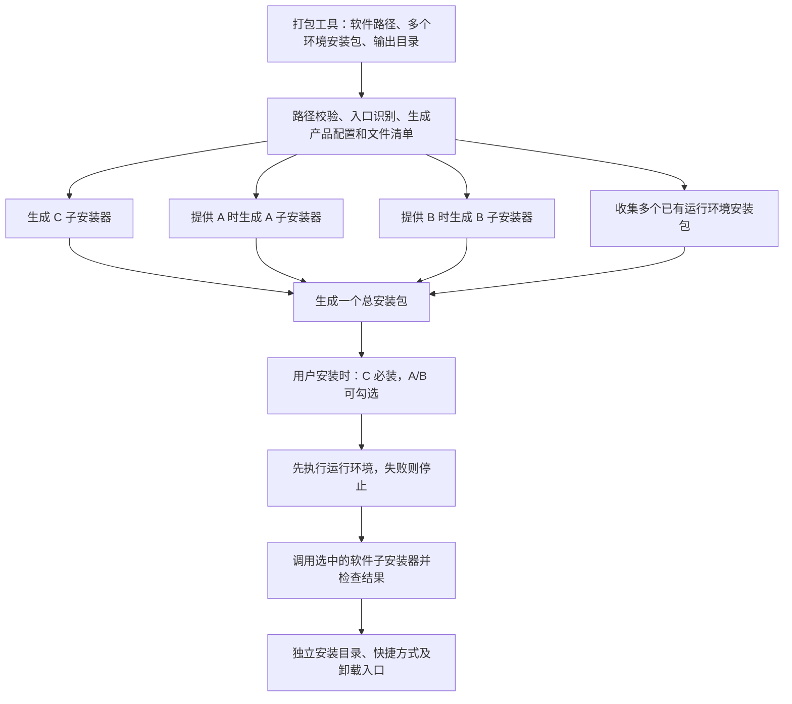

# 桌面软件统一安装包：需求分析与方案

日期：2026-10-14  
阶段：需求分析与 HTML 交互原型；原型确认后使用 Qt 实现桌面应用，尚未进行真实打包或安装测试。  
打包引擎：`D:\PCAPP\Inno Setup 7\ISCC.exe`

## 1. 目标与已确认需求

制作一个 Windows 图形界面打包工具，填写软件发布路径和安装包输出路径，点击“开始打包”，最终生成一个统一安装包。

三个软件的业务身份如下：

| 软件 | 用途 | 打包时的输入 | 用户安装时的行为 |
| --- | --- | --- | --- |
| A | 认证软件 | 路径可空；填写后收入总安装包 | 可勾选安装 |
| B | 引擎软件 | 路径可空；填写后收入总安装包 | 可勾选安装 |
| C | 功能软件 | 路径必填 | 默认必装，不允许取消 |

已确认的其他要求：

- 使用 Windows 图形界面，不要求操作者手写 Inno Setup 脚本或命令。
- 输入是已编译的软件发布目录，里面包含主程序及其依赖文件，不是已有的 Setup/MSI 安装包。
- A、B、C 独立运行，独立安装，没有业务上的安装先后要求。
- 整体交付一个安装包，运行安装包时勾选 A/B，再执行安装。
- 支持选择多个已有运行环境安装包（例如 VC++），收入总包，并先于全部业务软件安装。
- 先交付可审核的 HTML 原型；用户确认后，使用 Qt 严格对照原型开发桌面应用。

本方案将“独立安装”具体落实为：**各自安装目录、各自快捷方式、各自产品标识、各自卸载入口**。这是实现建议，后续可据此验收。

必须区分两个动作：**打包时填写 A/B 路径，决定总安装包是否包含它们；安装时勾选 A/B，决定在当前电脑上是否安装它们。**

## 2. 当前环境检查结果

| 检查项 | 观察结果 | 对方案的影响 |
| --- | --- | --- |
| 工作目录 | `D:\项目\CheckMCP\Doc\setup`，原有一个空文件 `1.tx` | 当前没有可复用的打包工具代码 |
| 编译器 | 指定目录存在 `ISCC.exe`，运行 `/?` 能显示 Inno Setup 7 帮助 | 可通过进程调用自动编译 `.iss` |
| 命令行能力 | 本机帮助列出 `/O`、`/F`、`/D`、`/Qp` 等参数 | 支持输出路径、输出名称及编译参数控制 |
| 本地文档版本 | `whatsnew.htm` 最新条目为 7.0.2，日期 2026-07-13 | 可参考随附文档分析 Inno Setup 7 能力 |
| 精确二进制版本 | `ISCC.exe`、`ISCmplr.dll` 的文件版本资源均为 `0.0.0.0` | 不能仅凭版本资源确认编译器的精确补丁版本 |
| 中文安装界面 | 存在 `Languages\ChineseSimplified.isl` | 可以生成简体中文安装界面 |
| 参考脚本 | 存在 `Components.iss`、`64Bit.iss` 等官方示例 | 组件选择、架构设置均有现成机制可用 |
| Qt 开发环境 | 尚未检查，留待原型确认后核实 | 不在原型阶段安装或实现 Qt 应用 |
| 实际待打包软件 | 尚未提供 A/B/C 发布目录 | 暂时无法验证真实文件、入口、运行库和安装行为 |

当前只验证了编译器能够启动并显示帮助，**未进行真实编译验证**。在线帮助可能随新版更新，实现时优先使用本机已显示支持的参数。

## 3. 架构选择

| 方案 | 实现方式 | 独立卸载能力 | 适用结论 |
| --- | --- | --- | --- |
| 单个 Inno 安装器直接复制三个组件 | `[Components]` 选择 A/B/C，统一管理安装文件 | 默认只有一个产品卸载入口 | 适合一个软件的功能组件，与本方案的三个独立软件存在差异 |
| **三个子安装器 + 一个总安装器** | 从发布目录生成 A/B/C 子安装器，总安装器负责选择与调用 | 每个子安装器登记自己的卸载入口 | **推荐，符合现有发布目录和独立安装要求** |
| 封装现有 Setup/MSI | 总安装器调用软件原有安装包 | 由原安装包负责 | 当前没有现成子安装包，不作为首版输入方式 |

推荐方案需要编译最多四次：C 子安装器、可选的 A/B 子安装器，以及总安装器。多个已有运行环境安装包直接封装，不重新编译。用户最终拿到一个总安装包，不需要分别运行各安装程序。



“没有安装顺序”表示三者不存在业务前置依赖。执行器可以在内部逐个运行并等待完成，以便显示结果、处理失败，不要求用户按顺序操作。

## 4. 打包工具界面

建议采用单窗口，常规操作只填写路径：

```text
桌面软件统一安装包制作工具

功能软件 C（必填）  [发布目录或主程序路径                  ] [浏览]
认证软件 A（可选）  [发布目录或主程序路径                  ] [浏览] [清空]
引擎软件 B（可选）  [发布目录或主程序路径                  ] [浏览] [清空]
运行环境安装包     [VC_redist.x64.exe                    ] [上移] [下移] [移除]
                   [VC_redist.x86.exe                    ] [上移] [下移] [移除]
                   [+ 添加多个 EXE / MSI 安装包]
安装包输出目录     [最终安装包保存位置                    ] [浏览]

本次包含：C、A、B
状态：等待打包
[开始打包] [取消] [打开输出目录]

打包日志与当前阶段……
```

路径和入口规则：

1. 首选选择软件的完整发布目录。目录顶层只有一个 `.exe` 时，将其作为入口。
2. 也允许直接选择主 `.exe`，明确入口；其所在目录视为发布根目录，完整收集其中的文件和子目录。
3. 目录顶层存在多个 `.exe` 时，弹出一次入口选择，不依靠文件大小或名称猜测。
4. 入口位于发布目录的深层子目录时，选择发布根目录后指定入口相对路径，保留完整目录结构。
5. A/B 留空表示不收入本次总安装包。填写了不存在的路径属于错误，不能静默忽略。
6. 软件名称、版本优先读取入口元数据；缺失时，名称使用主程序文件名，版本使用 `1.0.0`，摘要明确标注默认值，并允许在高级设置修改。图标从入口提取，无法提取时使用默认安装图标。
7. 首次识别出的入口及产品身份保存为配置，下次打包自动复用。

“只填写路径”的前提是发布目录边界明确、入口能唯一识别。多个入口等少数情况需要一次选择，避免把卸载器、更新器或辅助程序作为主入口。

## 5. 最终安装包的用户流程

建议流程：欢迎页 → 选择软件 → 安装摘要 → 安装进度 → 实际结果。

配置了运行环境时，安装进度分为两阶段：**先按列表顺序安装全部运行环境，再安装 C 与用户勾选的 A/B**。运行环境不是 A/B 软件选择项，配置到总包的环境默认执行；任一环境失败则停止后续软件安装。

软件选择页示意：

```text
请选择需要安装的软件

[✓] 功能软件 C（必装，不可取消）
[ ] 认证软件 A（可选）
[ ] 引擎软件 B（可选）
```

- 首版建议 A/B 默认不勾选，由用户主动选择；C 固定勾选。
- 没有收入总安装包的 A/B 不显示可选项，摘要明确列出本包包含的软件。
- 已安装的软件可显示“已安装”，勾选表示安装或更新；未勾选表示保持现状。
- 安装摘要分别展示选中软件的名称、版本和目标目录。
- 每个选中的子安装器使用静默参数运行，用户无需重复操作多个向导。
- 默认不在安装结束时自动启动 A/B/C，用户通过各自快捷方式运行。

软件包含情况与可选安装组合：

| 打包时提供的路径 | 安装时可选组合 |
| --- | --- |
| 仅 C | C |
| A + C | C、A + C |
| B + C | C、B + C |
| A + B + C | C、A + C、B + C、A + B + C |

**取消勾选 A/B 不表示卸载电脑上已经存在的 A/B。**

## 6. 文件、目录和产品身份

### 6.1 各软件独立落盘

建议每个子安装器使用自己的默认安装目录，例如：

```text
C:\Program Files\产品A\  → A 的发布目录内容
C:\Program Files\产品B\  → B 的发布目录内容
C:\Program Files\产品C\  → C 的发布目录内容
```

实际目录由产品配置与安装架构决定；32 位软件可能使用 `Program Files (x86)`。默认复用该软件此前的安装位置，总安装器不使用一个公共目录来覆盖三个软件。

每个软件内部保留原相对路径。快捷方式的工作目录默认设为入口 `.exe` 所在目录，可由产品配置覆盖。

发布目录应包含运行所需的 DLL、资源、模型、插件、配置及必要隐藏文件。不能只提取 `.exe`，也不能仅凭扩展名删除不认识的依赖。

### 6.2 稳定的独立产品标识

A/B/C 分别使用不同且稳定的 `AppId`，各自管理版本、安装位置、快捷方式和卸载记录。

- 同一产品升级时保持原 `AppId`，不因版本、源路径或本包包含哪些软件而变化。
- 若软件已有对外发布的安装版本，优先沿用其真实产品标识与升级规则；新生成的标识不能自动接管历史安装。
- 首次创建产品配置时生成标识，后续复用；配置可导出，换电脑打包时一并迁移。
- 配置保存在打包工具配置区，不写入原始发布目录。
- 产品身份不能只根据 A/B/C 角色确定；更换成另一个产品时应使用新的产品配置。
- C 更换时不能自动把原 A/B 当成新产品；同一 A/B 被不同总包复用时，应复用其自身产品配置。

### 6.3 路径检查与暂存

- C 必须存在且可读取；提供的 A/B 同样需要完整校验。
- 输出路径是目录，可创建并可写；明确区别于软件安装到用户电脑的位置。
- 输出目录、构建暂存目录不能位于任何输入发布目录内部，避免把生成文件再次打进去。
- 首版建议输入目录互不重叠；共享或嵌套发布目录需要先明确文件归属，再支持专用映射。
- 路径按 Windows 规则规范化，支持中文和空格；对目录链接等重定向单独检查，避免越过发布边界。
- 先生成文件清单并复制到本次构建暂存区，后续编译使用暂存副本，原发布目录保持只读。
- 复制中出现不可读文件或检测到源文件变化时停止，提示重新构建；不把不完整副本当成功。

## 7. Inno Setup 的职责分配

| 能力 | 子安装器 A/B/C | 总安装器 |
| --- | --- | --- |
| `[Setup]` | 各自 `AppId`、名称、版本和安装目录 | 总包名称与展示信息 |
| 安装目录 | 各自 `DefaultDirName`，复用已有位置 | 建议 `CreateAppDir=no`，不创建总包应用目录 |
| 卸载 | `Uninstallable=yes`，各自登记卸载入口 | 建议 `Uninstallable=no`，不产生额外的“总包卸载”入口 |
| `[Files]` | 收集自己的发布文件，保留子目录 | 内嵌多个环境安装包与软件子安装器，释放到本次临时目录 |
| `[Components]` | 首版不需要再选择内部功能 | C 使用 `fixed`，A/B 为可选项，仅生成实际包含的软件 |
| `[Icons]` | 各自开始菜单入口、可选桌面快捷方式 | 不统一接管软件快捷方式 |
| `[Code]` | 有实际需要时处理自身安装校验 | 先执行运行环境，再执行勾选的软件，检查退出结果并汇总 |
| 语言 | 简体中文 | 简体中文 |

总安装器设置 `CreateAppDir=no` 后，不能使用 `{app}` 作为总包文件落盘位置；其含义会变成 Windows 目录。子安装器应释放到 `{tmp}` 下本次独立目录，并在执行结束后清理。

子安装器可使用 `recursesubdirs` 保留子目录，配合 `createallsubdirs` 保留必要空目录。实际文件覆盖规则应区分程序文件与可修改配置，不对所有文件统一强制覆盖。

总安装器必须检查启动是否成功以及子进程退出码，不能只启动三个进程就宣告安装成功。仅靠普通 `[Run]` 项列出安装器，不能替代完整的结果汇总逻辑。

### 7.1 编译与静默安装参数

编译器调用关系为：

```text
ISCC.exe /O<本次子安装器输出目录> /F<输出文件基础名> <子安装脚本.iss>
ISCC.exe /O<本次总包编译暂存目录> /F<总安装包基础名> <总安装脚本.iss>
```

界面程序使用进程 API 和独立参数列表启动编译器，不通过拼接 PowerShell/CMD 命令执行。脚本使用 UTF-8，路径、产品名称和版本等值统一校验与转义。

因为子安装器由本工具生成，可以统一使用 Inno 静默参数，如 `/VERYSILENT /SUPPRESSMSGBOXES /SP- /NORESTART /RESTARTEXITCODE=3010`，并为每个软件指定独立安装日志。

两类退出码需要分别解释：

| 执行对象 | 退出码 | 处理 |
| --- | --- | --- |
| ISCC 编译器 | 0 | 编译成功，还需确认本次目标文件存在 |
| ISCC 编译器 | 1 | 命令行无效或发生致命错误 |
| ISCC 编译器 | 2 | 编译失败，展示对应日志 |
| 子安装器 | 0 | 成功 |
| 子安装器 | 3010 | 本方案显式配置的“成功但需要重启”，记录并在最后统一提示 |
| 子安装器 | 其他非零值 | 按失败或取消处理，记录原退出码 |

Inno 默认退出码 `8` 表示安装准备阶段无法继续且需要重启，不能当成安装成功。所有子安装器禁止自行重启系统。

### 7.2 多个运行环境安装包

- 打包界面支持多选添加 EXE/MSI，也支持逐项添加；列表可调整顺序、编辑参数、移除项目和去重。
- VC++ 安装包使用经过确认的厂商参数，例如 `/install /quiet /norestart`；MSI 通过系统 `msiexec` 调用。其他 EXE 的参数由对应安装包规则决定，不假定存在通用静默参数。
- 未配置参数的其他 EXE 默认使用自身安装界面，摘要明确展示；不可伪称其会静默执行。
- 各安装包使用独立暂存文件名与日志文件，避免不同目录下同名安装包相互覆盖。
- 每个包保存安装参数、成功退出码、重启退出码与检测规则。原型只演示参数，真实规则在 Qt/Inno 阶段验证。
- MSI 常见的 `0` 与 `3010` 分别表示完成与完成但待重启；其他厂商代码需要逐项定义。无法确认的非零退出码按失败处理。
- 禁止安装包自动重启；必须先重启才能继续的情况停止业务软件安装并提示用户，不能把所有“需要重启”都当作可继续。
- 运行环境不归 A/B/C 卸载器所有，卸载业务软件时不自动卸载这些共享运行库。

## 8. 构建流程与产物

1. 检查本机 `ISCC.exe`、语言文件、输入路径、入口和输出位置。
2. 读取或创建 A/B/C 的产品配置，展示本次包含的软件与版本。
3. 创建独立构建目录，收集发布文件和多个环境安装包、生成清单与暂存副本。
4. 生成并编译 C 子安装器；对提供路径的 A/B 做同样处理。
5. 所有需要的子安装器成功后，生成总安装脚本并编译。
6. 总安装包先生成到本次构建的输出暂存区，成功后再发布到用户指定输出目录。
7. 验证退出码、文件存在性及基本可读性，记录大小和 SHA-256。
8. 保留构建摘要、配置、脚本和日志；清理可重建的中间安装器及文件副本。

建议输出布局：

```text
用户指定输出目录\
  产品名称-版本-构建时间-Bundle.exe
  build-构建编号\
    manifest.json           # 本次软件、版本、入口、文件清单及产物校验值
    product-profiles.json   # 可复用的独立产品身份与安装配置
    scripts\               # 本次生成的子安装脚本及总安装脚本
    build.log               # 编译日志及错误摘要
```

新任务使用唯一文件名或构建编号，不以“目录里已有一个安装包”作为成功依据。首版不并发执行同一个界面的多个打包任务。

## 9. 安装失败、取消和日志

### 9.1 独立安装的失败边界

三个独立安装器不会天然构成一个可整体回滚的事务。

- 首版建议某个子安装失败后停止执行其余软件，并显示“部分完成”，列出成功、失败和未执行的软件。
- 不自动卸载已经成功安装的软件，避免误删此前已有的软件或用户数据。
- 单个子安装器负责自身支持范围内的回滚；总安装器只汇总实际结果。
- 用户可修复问题后重新运行总包，选择需要重试的软件。
- 总包发生失败或取消时，进程结果也应反映该状态，便于后续自动化判断。

### 9.2 取消规则

打包时可以取消当前编译任务，终止本任务子进程并清理本次未发布产物。安装时优先在子安装器之间响应取消，不强制结束正在修改系统的子安装器；界面应显示“当前软件完成后停止”。

### 9.3 日志留存

构建日志位于输出目录；安装日志保存在临时释放目录之外，例如本方案机器级安装模式下的 `%ProgramData%\DesktopBundleInstaller\Logs\<本次编号>`。分别记录总包与各子安装器结果，清理临时安装器后日志仍可查阅。

## 10. 升级、卸载和运行环境

- A/B/C 各自通过稳定 `AppId` 更新已有安装；总包不统一改变三个软件的版本号。
- 某次总包不包含 A/B，或用户没有勾选它们，均不删除此前已安装的 A/B。
- 卸载某个软件仅处理该子安装器管理的文件和入口，不连带卸载其他软件。
- 用户数据与授权数据按各软件的实际策略保留；不使用删除整个产品目录的通用规则。
- 可修改配置需明确“初装写入、升级保留”的文件规则，不能把发布目录内所有文件一律当作可覆盖程序文件。
- 首版建议采用机器级安装：总包统一请求管理员权限，各软件安装到自己的程序目录。若实际软件需要按用户安装，需另行定义一致的安装上下文。
- 软件应在正常用户权限下运行；需要写入安装目录的软件，要先明确数据目录或权限策略，不把整个安装目录开放为任意写入。

Inno 安装器位数与软件位数是不同概念。A/B/C 可以分别为 32 位或 64 位，各子安装器必须按自己的实际运行条件设置架构限制；不能仅依据开发电脑位数推断。

建议首轮在 Windows 10/11 x64 验收。最终支持范围取决于真实软件；.NET AnyCPU、原生 DLL、运行库等需要结合实际发布方式判断。VC++/.NET/WebView2 等运行依赖通过用户选择的已有安装包提供，不自动联网下载；原型不校验这些文件是否真实存在。

## 11. 已确定的技术路线

按用户要求，先制作 HTML/CSS/JavaScript 交互原型。原型为本地静态页面，路径选择、打包和安装均使用明确标注的演示状态，不调用真实安装程序。

用户审核并确认完整原型后，正式桌面应用使用 **Qt**，严格对齐原型布局、配色、字号、组件状态与交互流程。具体采用 C++ Qt 或 Qt 的 Python 绑定，在正式开发阶段结合开发与分发环境确定。

Qt 阶段接入系统文件对话框、多文件选择、后台工作线程、ISCC 子进程、日志和取消处理。打包工具使用现有 Inno Setup；最终安装软件的电脑无需安装 Inno Setup。

建议模块边界为：界面、输入校验与文件收集、产品配置、环境包配置、脚本生成、编译器调用、结果与日志。总安装器内另设运行环境优先执行、软件选择与结果汇总逻辑。

## 12. 后续开发顺序与验收

后续开发可分为四步：

1. 完成 HTML 原型并由用户确认，再用 Qt 实现对应界面及真实文件预检。
2. 先生成并验证一个 C 子安装器，再支持可选的 A/B 子安装器。
3. 生成总安装器，实现多个运行环境优先安装、C 必装、A/B 勾选、静默调用和结果汇总。
4. 使用真实发布目录完成打包、安装、运行、升级和独立卸载验收。

验收至少覆盖以下场景；下表是未来验收要求，不代表本次已经执行。

| 场景 | 预期结果 |
| --- | --- |
| C 为空，或填写的 A/B 路径无效 | 打包前明确报错，不生成成功产物 |
| 仅提供 C、提供 A+C、提供 B+C、提供 A+B+C | 均能生成对应总包，只包含实际提供的软件 |
| 完整总包分别选择 C、A+C、B+C、A+B+C | 新测试机上只安装选择的软件，C 始终安装 |
| 中文、空格路径，多个入口、深层入口 | 正确收集文件和处理入口；无法判断时要求选择 |
| 输出目录在输入目录内，或输入目录重叠 | 阻止构建并指出冲突 |
| DLL、资源、必要空目录、隐藏配置 | 按发布清单保留；安装后软件可以正常运行 |
| 每种已安装软件 | 各自目录、快捷方式和卸载入口正确，独立启动 |
| 未勾选 A/B，但电脑已有 A/B | 保留原安装，不执行更新或卸载 |
| 任一子安装器编译失败 | 不发布总包，显示对应软件与错误 |
| 任一子软件安装失败或安装被取消 | 报告实际完成情况，不伪报整体成功 |
| 多个运行环境安装包 | 支持添加、排序、参数配置；先于任何业务软件执行 |
| 运行环境安装失败 | 停止后续软件安装，显示包名、退出结果与日志 |
| 子安装器要求重启 | 不立即重启，最终统一提示并保留结果 |
| 同一软件再次打包并覆盖升级 | 使用原产品身份；用户配置按规则保留 |
| 单独卸载 A、B 或 C | 其他软件仍可运行，卸载范围与数据保留规则正确 |
| 普通用户启动总安装包 | 权限请求与实际安装模式一致，各软件后续可正常运行 |

正式开发前还需要实际 A/B/C 样本，用于确定主入口、产品名称和版本、目标系统与架构、运行依赖、可写配置及授权数据目录。这些信息不影响本次架构分析，但决定最终安装脚本的具体规则。

## 13. 参考依据

本地已检查：

- `D:\PCAPP\Inno Setup 7\ISCC.exe /?`
- `D:\PCAPP\Inno Setup 7\whatsnew.htm`
- `D:\PCAPP\Inno Setup 7\Examples\Components.iss`
- `D:\PCAPP\Inno Setup 7\Examples\64Bit.iss`
- `D:\PCAPP\Inno Setup 7\Languages\ChineseSimplified.isl`

官方文档：

- [编译器命令行与退出码](https://jrsoftware.org/ishelp/topic_compilercmdline.htm)
- [Components 组件选择](https://jrsoftware.org/ishelp/topic_componentssection.htm)
- [AppId 产品身份](https://jrsoftware.org/ishelp/topic_setup_appid.htm)
- [CreateAppDir](https://jrsoftware.org/ishelp/topic_setup_createappdir.htm)
- [Uninstallable](https://jrsoftware.org/ishelp/topic_setup_uninstallable.htm)
- [Files 文件收集](https://jrsoftware.org/ishelp/topic_filessection.htm)
- [Icons 快捷方式](https://jrsoftware.org/ishelp/topic_iconssection.htm)
- [安装器命令行参数](https://jrsoftware.org/ishelp/topic_setupcmdline.htm)
- [安装器退出码](https://jrsoftware.org/ishelp/topic_setupexitcodes.htm)
- [安装器架构](https://jrsoftware.org/ishelp/topic_setup_setuparchitecture.htm)
- [安装权限](https://jrsoftware.org/ishelp/topic_setup_privilegesrequired.htm)
